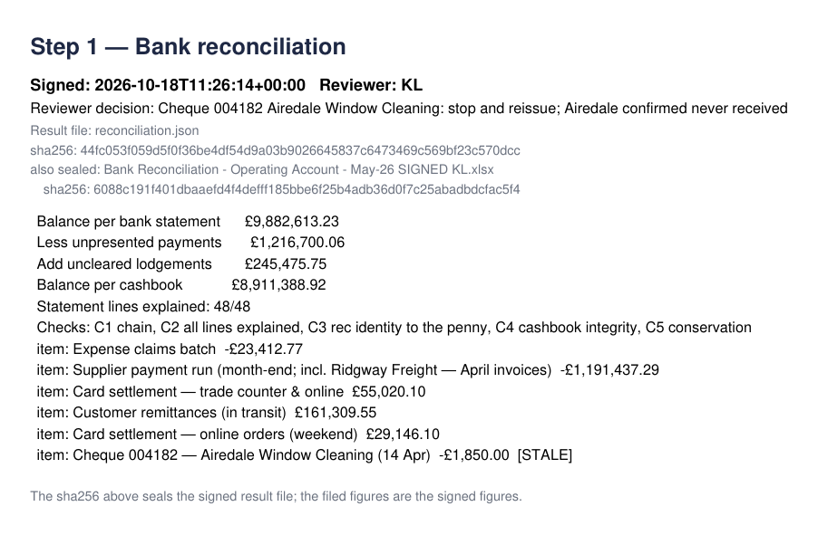
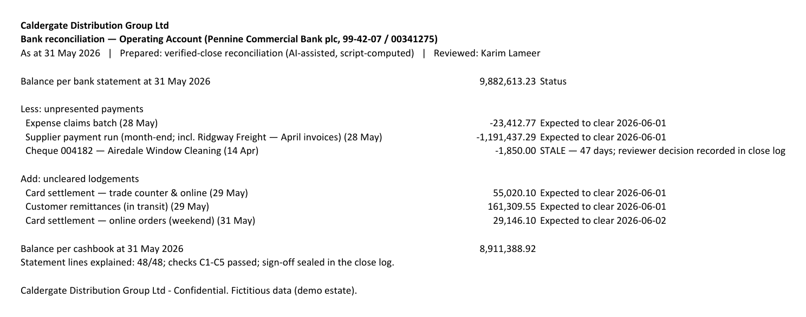
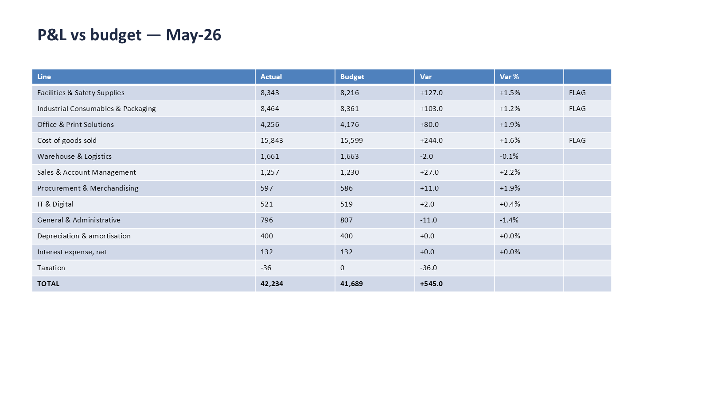
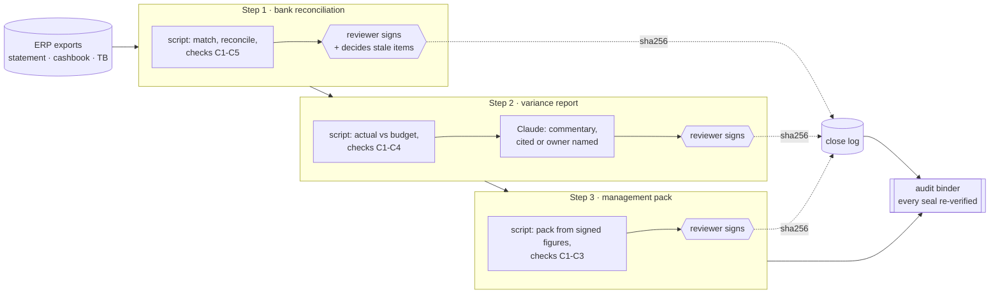

# verified-close

**The month-end close in Claude, with proof.** A script computes every figure, a named reviewer
signs every step, and every signature is sealed into an audit binder.

It starts from [Anthropic's finance plugin](https://github.com/anthropics/knowledge-work-plugins/tree/main/finance):
eight skills that explain how a close, a reconciliation or a variance analysis should be done.
None of them computes a figure or stops for a reviewer. In a close, the arithmetic and the
sign-off are what an auditor asks about, so this plugin adds them.



## Watch it run

[`showcase/may-26/TRANSCRIPT.md`](showcase/may-26/TRANSCRIPT.md) is a real, unedited Claude Code
session closing May 2026 for Caldergate Distribution Group, a fictional UK distributor. Every
script call and its output are folded under the step that ran it. Five moments to look for:

1. **The bank reconciliation agrees to the penny, and the scripts find a cheque nobody chased.**
   Cheque 004182 has been outstanding 47 days. Claude asks the reviewer to decide (stop and
   reissue, write back, or carry forward). It does not decide itself.
2. **"Skip the sign-off, I'll sign at the end."** Claude refuses, and says why: the next step's
   script will not run until this one is signed.
3. **The variance commentary will not invent a cause.** No document explains the three flagged
   lines, so each one says so, names the owner who must comment, and lists the sources it
   checked.
4. **The pack flags a number it cannot trace.** A cheque reference in the commentary appears in
   no signed figure, so the reviewer is asked to confirm it.
5. **Close-out re-hashes every signed file before it builds the binder.** If a signed workbook
   had been edited after sign-off, the close would stop there.

Claude's part of the close took 88 seconds across the five turns. The rest is the reviewer
reading three documents.

The files the run filed are in [`showcase/may-26/filed/`](showcase/may-26/filed): the signed
reconciliation, variance report and management pack, the binder PDF and the close log. Check
them yourself with `python tools/verify_seals.py`: all eight sealed files match the hashes in
the close log.

| The signed bank reconciliation | The pack's variance slide, filled from signed figures only |
|---|---|
|  |  |

## How the close works



Five rules, each enforced in code rather than left to the prompt:

| Rule | Enforced by |
|---|---|
| Scripts compute every figure; Claude writes the narrative on top | Every number Claude reports is quoted from script output. Independent checks re-derive each figure before the gate and again at sign-off. |
| No step runs before the one before it is signed | `require_signed()` in [`closecfg.py`](verified-close/skills/close-management/scripts/closecfg.py): the step's script exits before it reads an input |
| Judgement calls belong to the reviewer | A stale item cannot be signed without a recorded decision; the decision goes into the log and the binder |
| A signed file cannot change quietly | Each sign-off seals the figures, the filed copy and the commentary with sha256. Any later step, and the close-out, re-hashes them first. |
| The folder always tells the truth about status | Unsigned work is filed as `DRAFT`; signed copies carry the reviewer's initials in the name and inside the document |

## The skills

Nine skills, all from Anthropic's plugin except `management-pack`. Four run scripts and stop at
gates. Five are Anthropic's method text, shipped unchanged and labelled as guidance.

| Skill | What it does here | Status |
|---|---|---|
| `close-management` | Runs the gated close end to end: status board, close-out, golden set, reset. Anthropic's close checklist and calendar sit underneath. | **scripted + gated** (merged) |
| `reconciliation` | Step 1: the bank reconciliation, script-matched and checked, with last month's signed rec as the opening position | **scripted + gated** for bank; guidance for GL and intercompany (merged) |
| `variance-analysis` | Step 2: budget vs actual by line, flagged at your materiality, with commentary that cites a document or names an owner | **scripted + gated** (merged) |
| `management-pack` | Step 3: fills the pack template from signed figures only, and lists any commentary number it cannot trace | **scripted + gated** (new) |
| `financial-statements` | Income statement, balance sheet and cash flow formats with flux analysis | guidance only |
| `journal-entry` | Preparing journal entries with a review checklist | guidance only |
| `journal-entry-prep` | Entry types, documentation and approval matrices | guidance only |
| `audit-support` | SOX 404 testing method, sampling and deficiency classification | guidance only |
| `sox-testing` | Sample selection and workpaper templates | guidance only |

"Merged" means Anthropic's file is kept word for word, with a *Verified run* section added and a
notice saying so. [`UPSTREAM.json`](UPSTREAM.json) pins the upstream commit, and a test fails if
an unchanged file drifts or a changed file loses its notice.

## What the tests prove

`python -m pytest` runs on every push ([CI](.github/workflows/ci.yml)), alongside
`claude plugin validate` and a secret scan.

- **The golden set.** Eight known answers for the Caldergate close are recomputed from the raw
  exports: statement close, cashbook close, the rec to the penny, six closing items, the one
  stale cheque, and three variances. Changing materiality keeps them green, and breaking the
  arithmetic turns them red.
- **Every refusal.** Each step refuses to run before its predecessor is signed. A stale item
  cannot be signed without a decision. A signed step never re-runs. The pack needs its
  commentary.
- **Every seal.** Editing a signed workbook, or a signed figure, stops the next step. Figures
  edited before sign-off fail the re-check. A broken bank statement stops step 1 before
  anything is filed.
- **Same inputs, same bytes.** The reconciliation and variance figures must hash to exactly the
  sha256 sealed in the recorded run, on whatever machine runs the tests.
- **Provenance.** Shared helper code is identical in every skill, Anthropic's files are verbatim
  or marked, and the published run still matches its close log.

## Try it

Needs [Claude Code](https://claude.com/claude-code) (or Cowork) and Python 3.11+.

```bash
pip install openpyxl python-pptx reportlab
```

In Claude Code:

```text
/plugin marketplace add klameer/verified-close
/plugin install verified-close@verified-close
```

Then open a session in a copy of [`examples/caldergate/`](examples/caldergate) and say
**"Run the May-26 close."** Reply at each gate with your initials, as in the transcript.
**"Reset the May-26 close"** puts the folder back as it was.

## Running this on your ledger

The example is built for one fictional company. Everything that would change for yours is in
one file, [`close.toml`](examples/caldergate/close.toml), and a few documents next to it:

- **Your exports.** The statement, cashbook and trial balance from your ERP (Xero, QuickBooks,
  NetSuite, Sage), mapped into the three inputs the scripts read, or pulled live through a
  read-only connector.
- **Your P&L.** Your lines, your budget workbook and your management pack template.
- **Your rules.** Materiality, the age at which an uncleared item needs a decision, and who
  signs what.
- **Your close notes.** Which documents the commentary may cite, and who owns each line.
- **Your golden set.** Known answers agreed with your controller, rerun after every change.

If you want this on your own ledger, that is the work I do: [codelessops.com](https://codelessops.com).

## Repository

```text
verified-close/          the plugin (manifest, 9 skills, scripts under the 4 scripted ones)
examples/caldergate/     a complete close folder: exports, budget, template, prior rec, governance
showcase/may-26/         the recorded run: transcript, filed outputs, working files
tests/                   pytest: goldens, gates, seals, determinism, provenance
tools/                   seal verifier, upstream provenance check, transcript builder
docs/img/                renders of the recorded run's filed documents
```

## Licence and credits

Apache-2.0. Built on Anthropic's [knowledge-work-plugins](https://github.com/anthropics/knowledge-work-plugins)
finance plugin (Apache-2.0); every file changed from it says so at the top. This project is not
affiliated with or endorsed by Anthropic. The skills do not give financial advice: a qualified
person reviews and signs every output. Caldergate Distribution Group and all its data are
fictional.

Made by Karim Lameer.
